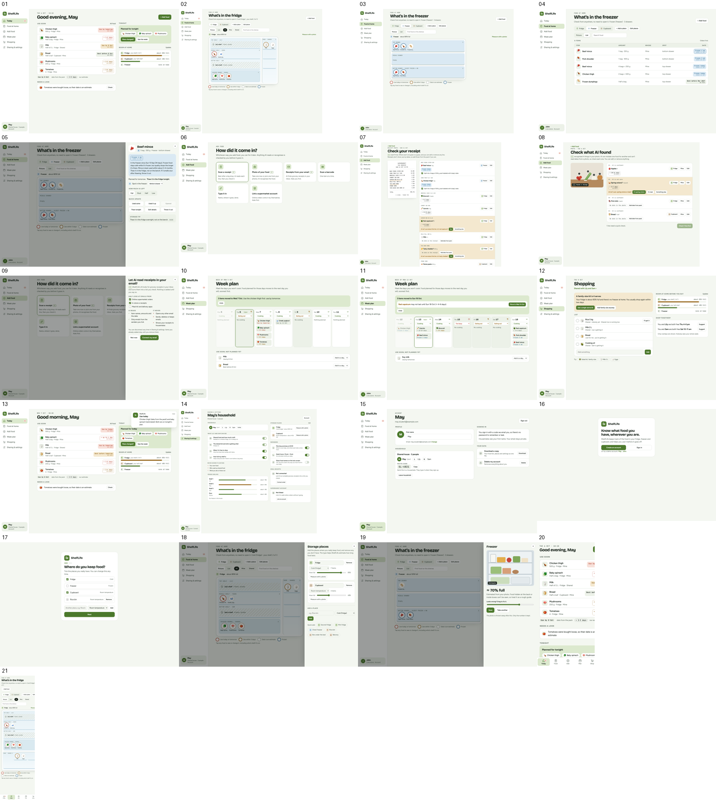

# ShelfLife 设计雏形（lo-fi）· v0.2 · 2026-10-06

> **English summary.** A low-fidelity, clickable prototype for our INFO90006 design concept (working name *ShelfLife*). It is built from the five functional requirements, the ethical requirements and the two personas (May, John) in our submitted report. Open `index.html` in Chrome. AI results, photo capacity estimates, email sign-in and push reminders are simulated. All food data is made up. This is a draft for the team to discuss; the final concept, scenario wording and reflection are ours to write.

INFO90006 小组项目 design concept 的低保真可点击原型。它按已提交报告的 5 条功能需求、伦理需求，以及 May、John 两个人物角色搭建，给小组讨论用，也是录 concept video 的底稿。**ShelfLife 是暂名。**

## 怎么打开

- **本地**：在这个仓库页面点 Code → Download ZIP（或 `git clone`），解压后用 Chrome 打开 [index.html](index.html)。不需要登录，也不需要服务器。
- **在线**：https://claude.ai/artifact/NsvPi4E2S7NtzmcDrq2xw5 。链接是私有的，需要嘉阔在 Share 里给你开权限；打不开就用本地文件。
- **手机**：用手机浏览器打开在线链接，左侧导航会变成底部标签栏。拍照按钮会直接调用相机或相册。
- 顶部紫色的**演示栏**可以切换 May / John，点 1–4 跳到场景里的某一刻，"新用户注册"从欢迎页开始。右侧的**设计注释**写着每页对应的需求、报告依据和待定事项。
- 录屏前：关掉"需求标签"，关掉设计注释，再点"收起"。

## 雏形做到什么程度

| 是真的 | 是模拟或占位的 |
|---|---|
| 页面、导航、每个按钮的交互 | AI 读小票、读邮件、识别照片的结果（固定示例） |
| 计划改了以后自动挪菜、提醒放不到那天的食物 | 拍照估计冰箱有多满（固定示例值） |
| 存放位置的增删改，食物移到别的层 | 邮箱验证码登录（不会真的发邮件，填任意 6 位数） |
| 小票每一行都能编辑、删除、确认 | 推送提醒（在页面里模拟） |
| 合租时隐藏室友私有的食物 | 条码扫描、下载数据、更换邮箱（只有提示） |

- 数据不保存：刷新页面或点"重置"，都会回到示例数据。
- 示例食物和日期是编的，不是参与者数据。May 和 John 来自报告里的 persona。
- 储存小贴士、"肉末冷冻 3–4 个月"这类说法还没查官方来源，进视频或报告前要先核对（如 FSANZ、Food Safety Information Council）。

## 页面一览

需求编号按已提交小组报告里"功能需求"的顺序：R1 记录与查看，R2 储存与新鲜度，R3 灵活计划，R4 合租协调，R5 空间意识，E 伦理需求。

| # | 截图 | 页面 | 演示了什么 | 需求 |
|---|---|---|---|---|
| 01 | [Today](截图/01_Today_May.png) | 首页 | 快到期的、今晚计划、要核对的、各处剩多少空间 | R1 R2 R3 R5 |
| 02 | [冰箱可视化](截图/02_冰箱可视化_May合租.png) | Food · Picture | 三层、保鲜抽屉、门架；红圈、黄圈、虚线圈、蓝圈；室友那层上锁 | R1 R2 R4 E |
| 03 | [冷冻室可视化](截图/03_冷冻室可视化_John.png) | Food · 冷冻室 | 三个抽屉，最底层标"冻了 4 周" | R2 R3 |
| 04 | [食物列表](截图/04_食物列表_John冷冻室.png) | Food · List | 表格视图，可搜索 | R1 |
| 05 | [食物详情](截图/05_食物详情_最旧那袋肉.png) | 单个食物 | 日期从哪来、解冻指引、计划、移到哪一层、快捷更新 | R1 R2 R3 |
| 06 | [录入方式](截图/06_Add_food录入方式.png) | Add food | 扫小票、AI 照片、AI 读邮箱、条码、手打、超市账户 | R1 E |
| 07 | [扫小票核对](截图/07_扫小票核对_John.png) | 核对页 | 小票原图和识别结果对照；逐行编辑；肉分袋 | R1 R2 |
| 08 | [AI 照片识别](截图/08_AI照片识别结果_May.png) | 核对页 · 照片 | 照片上标号；AI 不确定时问"葱还是韭葱" | R1 E |
| 09 | [AI 读邮箱同意页](截图/09_AI读邮箱同意页.png) | 同意页 | 只看勾选的寄件类别；读什么、不读什么 | E R1 |
| 10 | [周计划重排](截图/10_周计划重排_May.png) | Week plan | 今晚出去吃，菜挪到周三，最急的排第一 | R3 R2 |
| 11 | [周计划提醒](截图/11_周计划提醒_John.png) | Week plan | 三天不做饭，彩椒放不到周日，提醒提前用 | R3 R2 |
| 12 | [购物空间提醒](截图/12_购物空间提醒_May.png) | Shopping | 大包沙拉放不下；共享清单、谁去买、一起去买 | R4 R5 |
| 13 | [推送提醒](截图/13_推送提醒_May.png) | 提醒 | 今天要用什么，日期来源标明 | R2 |
| 14 | [共享与设置](截图/14_共享与设置_May.png) | Sharing & settings | 室友能看到什么、冰箱分层、存放位置、提醒、邮箱、超市账户 | E R4 R5 |
| 15 | [账户页](截图/15_账户页_May.png) | Account | 资料、合租组和邀请码、下载或删除数据、退出登录 | E R4 |
| 16 | [欢迎与登录](截图/16_欢迎与登录页.png) | 欢迎页 | 注册或登录，可试演示账户 | E |
| 17 | [首次设置](截图/17_首次设置_存放位置.png) | 注册第 1 步 | 你在哪些地方放食物（可以加米桶等） | R1 R5 |
| 18 | [编辑存放位置](截图/18_编辑存放位置.png) | Storage places | 增删改名、选类型、手动调多满 | R1 R5 |
| 19 | [拍照估计容量](截图/19_拍照估计容量.png) | Measure | 拍照得到约 70% 满，可以拖动修正 | R5 E |
| 20 | [手机 Today](截图/20_手机_Today.png) | 手机宽度 | 底部标签栏 | 技术环境 |
| 21 | [手机冰箱](截图/21_手机_冰箱可视化.png) | 手机宽度 | 冰箱可视化在手机上的样子 | 技术环境 |

## 功能对应需求和发现

| 需求 | 雏形里的功能 | 报告依据 |
|---|---|---|
| R1 记录与查看 | 扫小票、AI 照片、AI 读邮箱、条码、手打、超市账户，都要人核对并能逐行修改；在外面也能看家里有什么 | F1 靠记忆和开冰箱看；F2 记录太费劲（P2"每样都拍照几乎不可能"） |
| R2 储存与新鲜度 | 包装日期用实心框，估计日期用虚线框并写明依据；按位置和层分开；冷冻按日期排序；储存小贴士 | F3 没有日期、标签消失、解冻后发酸 |
| R3 灵活计划 | 标出外食或太忙的日子，菜自动挪、最急的排前、放不到的提醒提前；"今晚出去吃"一键完成 | F4 计划随日程变（P1、P2、P6） |
| R4 合租协调 | 个人和共享分开；室友那层上锁；共享清单写清谁去买；重复购买提醒但允许给自己买；只显示重叠的空闲时间；邀请码合租组 | F5 归属不清、被用掉不知道、重复购买 |
| R5 空间意识 | 各处多满；买大包装前提醒；冷冻室里还剩几袋；拍照粗估 | F6 没冷冻室、抢冰箱空间、放不下 |
| 伦理需求 | 只和授权住户共享；不记录谁用完共享食物；连账户或读邮箱先征得同意；估计日期明确标出；照片不保存；能删账户 | 报告伦理需求原文 |

## 两个未来场景（草稿，小组要用自己的话重写）

由报告里的现状场景改写成"有了 ShelfLife 之后"，演示栏里点数字就能跳到对应那一刻。

**May**（合租，共用冰箱，没有冷冻室，几乎天天买）
1. 周二 18:10，朋友约她出去吃。她打开网站，今晚原本要做的菜和快坏的东西一页就能看到。（截图 01）
2. 选 "Eating out tonight"，菜自动挪到周三，最急的鸡腿肉排第一。（截图 10）
3. 周三 08:00 收到提醒：今天要用鸡腿肉（包装日期）和菠菜（估计）。（截图 13）
4. 周四在超市想买大包沙拉，被提醒冰箱放不下；加牛奶时，被提醒 Lily 已经在买。（截图 12）

**John**（一个人住，有冷冻室，一次买一到两周）
1. 周日大采购后扫小票：9 行自动识别，2 行要他确认，日期从包装补。（截图 07）
2. 肉分袋进冷冻室，每袋自动带上冷冻日期，新袋子放上层。（截图 03）
3. 周二晚：周四期中，加上两次出去吃。他标出这三天，菜自动挪；彩椒放不到周日，被提醒提前用。（截图 11）
4. 周六打开冷冻室，最底层冻了 4 周的旧肉排在最前，附解冻指引。（截图 05）

## 已经做过的设计判断

- **网站还是 App**：网站版在电脑和手机浏览器都能用，满足报告"能在智能手机上使用"的技术环境要求。最后用哪种形态，小组定。
- **拍照估计容量**：可以做，但只能粗估，所以做成可选功能。被挡住的后排和不透明容器看不到，照片也会过时，所以必须能手动改。合租冰箱的照片会拍到室友的食物，因此照片只用来算一个百分比，不保存。写进报告前，要先找产品先例或文献来支撑。
- **AI 读邮箱**：比连超市账户更侵入隐私，所以只看用户勾选的寄件类别。更窄的替代做法是让用户把收据转发到一个专用地址，可以写进 Reflection。
- **AI 都要人来核对**：小票、邮件、照片识别出的结果，都要用户核对后才加入；AI 不确定的行，以及它认为不是食物的东西，都需要用户点一下决定。报告里引用了 Jaramillo et al. (2026) 的 human-in-the-loop 做法。
- **室友隐私**：不记录谁用完了共享食物，避免变成室友之间互相监视或指责（报告伦理需求原话）。
- **日期**：包装上的日期和估计的日期在视觉上分开，避免把估计当成食品安全保证。
- **不做的**：菜谱、营养追踪、智能冰箱硬件、用照片判断食物能不能吃（见小组 2026-09-15 的设计想法汇总第五节）。

## 待小组决定

- App 的名字。
- 形态：网站还是 App。
- 视频主推哪种录入方式（目前演示的是扫小票和 AI 照片）。
- "一起去买"的空闲时间功能、拍照估容量、AI 读邮箱，这三个功能各留不留。
- 邀请码要不要过期；有人搬走时，他标成共享的食物归谁。
- 视频形式：纯录屏，还是真人实拍加录屏。
- 储存小贴士和保存期限的说法，要配上官方来源。

## 版本记录（2026-10-06）

| 版本 | 内容 |
|---|---|
| v0.1 手机版 | 手机外框里的 App 壳：Home、Food、Add、Plan、Shop 五个页签；May 和 John 各 4 步场景 |
| v0.2 网站版 | 改成网页形态：左侧导航、六个页面、演示栏、设计注释、成片安排 |
| v0.2 后续修改 | 存放位置可增删改，拍照估容量 → 食物和地方配图标 → 小票逐行可编辑、AI 读邮箱、照片支持现拍和相册并标明 AI 识别 → 账户（验证码登录、首次设置、合租组、删除账户）、冰箱、冷冻室和橱柜的可视化 |

## 文件

| 文件 | 说明 |
|---|---|
| `index.html` | 当前版本（网站版 v0.2），用 Chrome 打开 |
| `phone-v0.1.html` | 早期的手机 App 外框版本，没有跟着后续修改更新 |
| `截图/` | 21 张关键页面截图（浅色主题，电脑 1440 宽，手机 390 宽），加一张总览 |

改原型：直接改 `index.html`（单个文件，样式和脚本都在里面），用浏览器打开就能看效果。改完提交，并在提交说明里写清改了什么。

## 视频与 2 页报告安排

截止 **2026-10-20（周二）15:00**，小组提交一次：3 分钟 design concept video + 2 页报告（报告里放视频链接）。评分四项各 5 分：Structure & engagement、Design concept、Scenario、Reflection。

### 3 分钟怎么分（建议）

| 时间 | 内容 | 主要得分项 |
|---|---|---|
| 0:00–0:20 | 问题：8 位学生的 fieldwork 里，食物被忘、计划会变、合租难协调 | Structure & engagement |
| 0:20–0:40 | 概念登场：名字、一句话定位、五个功能快速闪过 | Design concept |
| 0:40–1:40 | May：朋友约饭 → 今晚出去吃 → 菜挪到周三 → 周三提醒 → 超市里看空间和共享清单 | Scenario |
| 1:40–2:35 | John：扫小票、肉分袋 → 期中打乱计划 → 冷冻室最旧的先用 | Scenario |
| 2:35–3:00 | 功能对需求一屏 + 一句伦理设计 | Design concept · Reflection |

### 2 页报告骨架

1. Design concept：概述 + 功能 → 需求 → 发现对照表（可以直接改上面那张）。
2. Scenarios：May、John 各一小段，附视频链接。
3. Ethical issues & unintended uses：从报告伦理需求出发（室友互相盯着、估计日期被当成安全保证、超市账户数据、提醒带来内疚）。
4. Future development & evaluation：先做哪部分、找谁测、测什么。

### 时间表

| 日期 | 事 |
|---|---|
| 10/7–10/8 | 小组过一遍这个设计雏形：功能留哪些、砍哪些，定名字和分工 |
| 10/9–10/11 | 原型定稿（改这份 HTML 或搬进 Figma）；用自己的话写两个未来场景；storyboard |
| 10/12–10/14 | 录屏，配音或实拍 |
| 10/15–10/16 | 剪到 3:00 以内，加字幕 |
| 10/17–10/18 | 写 2 页报告，放视频链接，确认导师能打开 |
| 10/19 | 按 rubric 审一遍 |
| 10/20 15:00 | 截止 |

## AI 使用说明

这个雏形由 AI（Claude）按小组已提交报告里的需求、发现和人物角色搭建，是讨论底稿，不是定稿。功能取舍、视频里的场景文字和报告里的 Reflection，由小组自己决定、自己写。提交时按课程规则，在报告里写明 AI 的用途，写法和上次报告的致谢保持一致。
