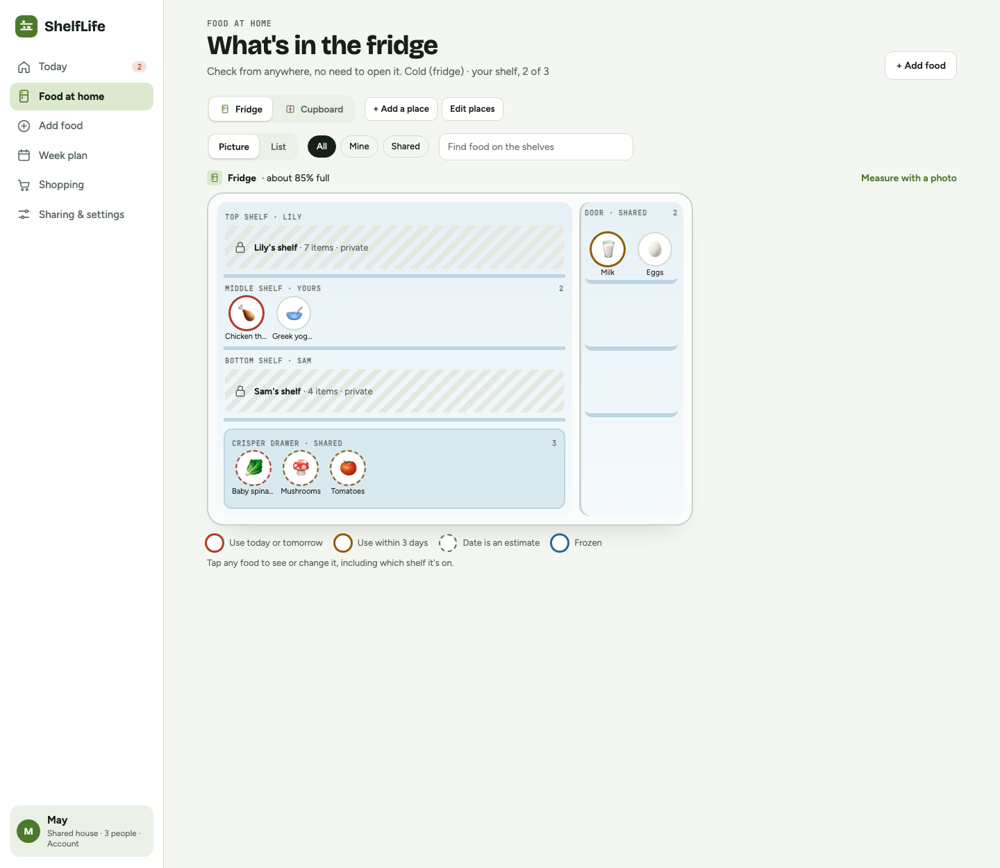
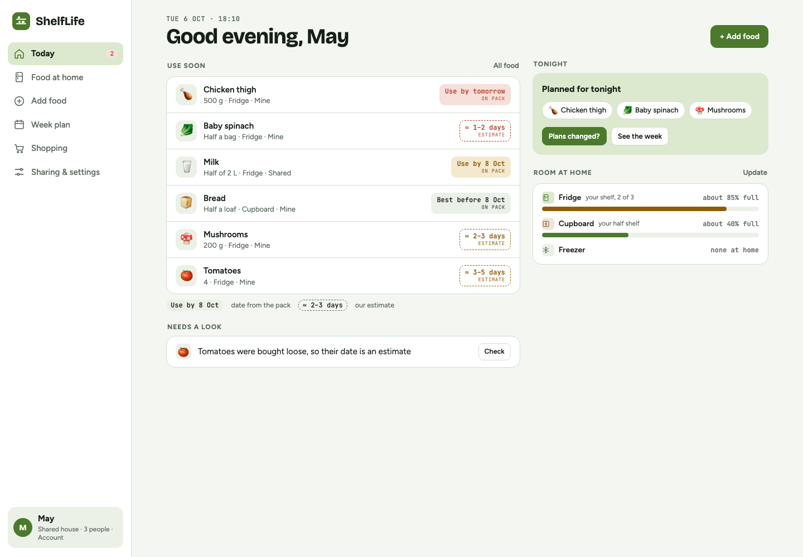
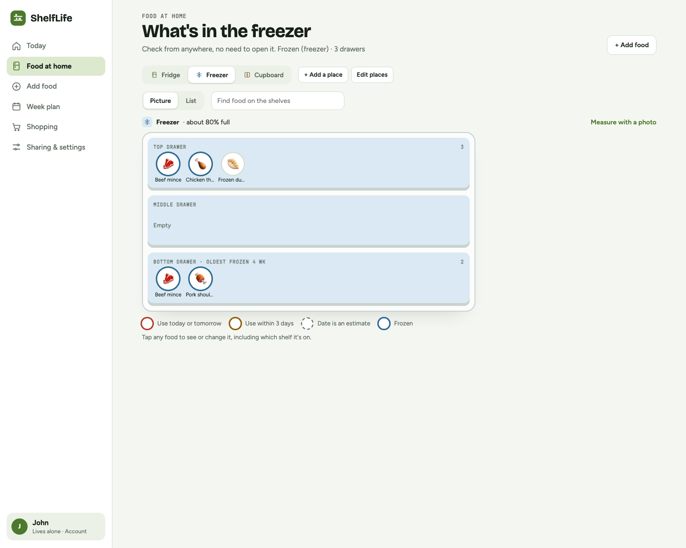
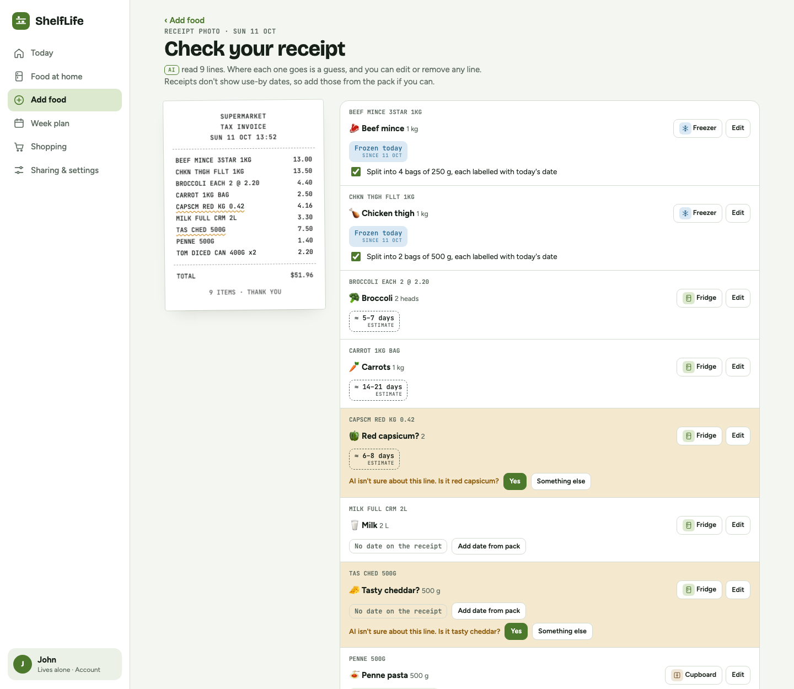
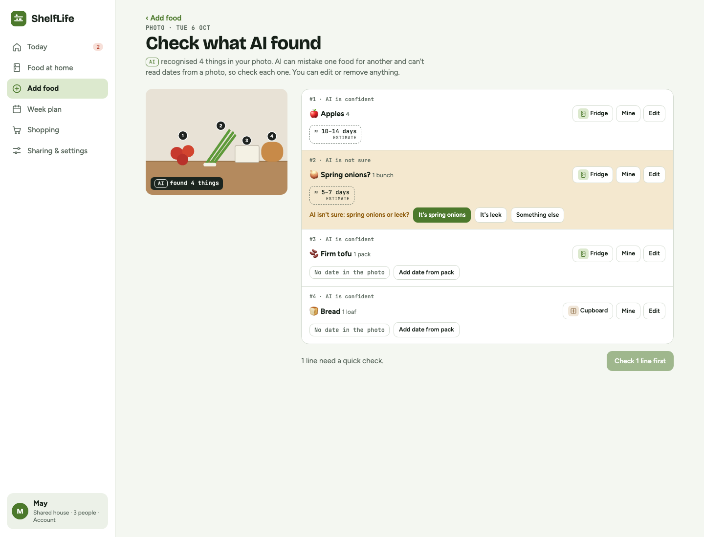
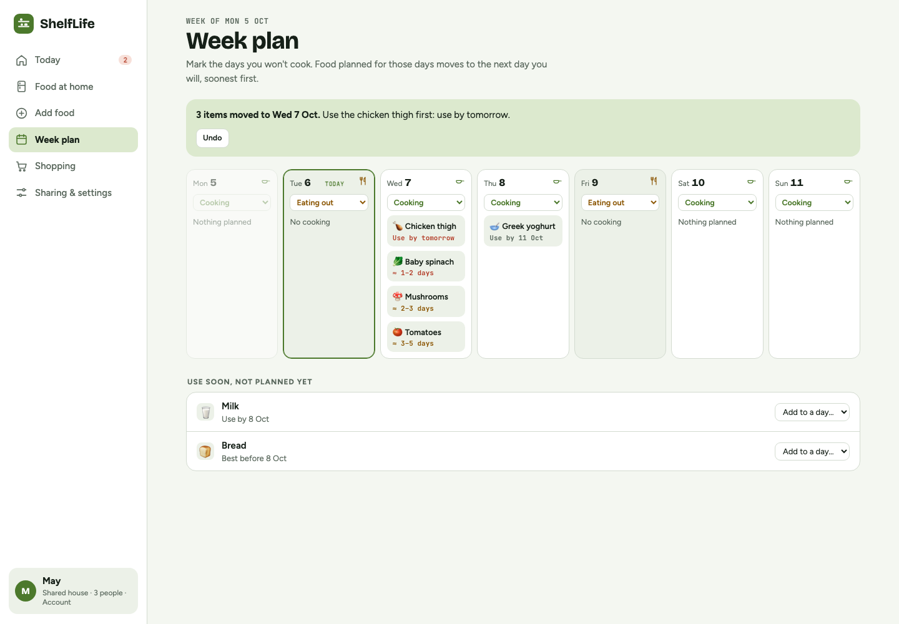
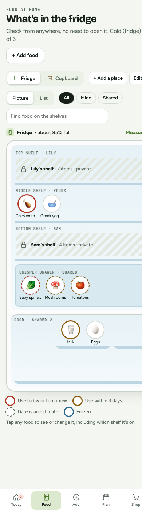

# ShelfLife · INFO90006 设计概念原型

> **更新（2026-10-09）：** 产品方向已改为 **Eat It!**（手机 App 概念，两个 persona，虚拟冰箱加桌面小组件）。最新文档在 `docs/Eat-It_*.md` 和 `docs/VISUAL-SPEC.md`，AI 助手请先读 [AGENTS.md](AGENTS.md)。下面的内容和 `index.html` 是 v0.2 旧版 lo-fi 原型的说明，仅作历史记录。

帮大学生管好家里的食物、少浪费：知道冰箱里有什么、哪些该先吃，录入尽量不用手打。
这是我们 INFO90006 小组项目的 **lo-fi 可点击原型**（暂名 ShelfLife），用来讨论设计和录 concept video。

> **English summary.** A low-fidelity, clickable prototype for our INFO90006 design concept. It is built from the findings (F1–F6), functional requirements (R1–R5), ethical requirements and personas (May, John) in our submitted fieldwork report. Open `index.html` in Chrome; nothing to install. AI results, photo estimates, email sign-in and reminders are simulated, and all food data is made up. Jenny's advice and our plan are in [PLAN.md](PLAN.md). If you use an AI assistant, it should read [AGENTS.md](AGENTS.md) first.

## 现在到哪一步了

- ✅ v0.2 原型完成：网站版，电脑和手机浏览器都能用，有 21 张截图。
- ✅ 10/6 小组会和 Jenny 聊过视频要求，结论和计划都在 **[PLAN.md](PLAN.md)**。
- ⏳ **周五 10/9 下午**小组会：定 1–3 个核心功能、视频用哪个 persona、分工。会上说好**先不大改前端**，等定了再按高保真重做。
- 🎯 **10/20（周二）15:00** 截止：3 分钟视频 + 2 页报告。

## 快速开始

1. 点右上角 **Code → Download ZIP** 解压，或者 `git clone https://github.com/wannian001/info90006-shelflife.git`。
2. 用 **Chrome** 打开 `index.html`。不需要登录、服务器，也不需要安装任何东西。
3. 顶部紫色的**演示栏**：
   - 切换 **May**（合租、没有冷冻室）或 **John**（一个人住、有冷冻室）。
   - 点 **1–4** 跳到场景里的某一刻；点 **新用户注册** 走一遍注册流程。
   - 打开 **设计注释**，右边会显示这一页对应哪条需求、报告依据、还要我们决定的事。
4. 录屏前：关掉"需求标签"，关掉"设计注释"，再点"收起"。

## 主要页面

| | | |
|---|---|---|
|  |  |  |
| **Today**：快坏的、今晚计划、各处空间 | **冷冻室**：最旧的那袋排在最前 | **扫小票**：AI 识别，每行都能改 |
|  |  |  |
| **AI 照片识别**：不确定的会问你 | **计划变了**：菜自动挪到别的天 | **手机上**：底部标签栏 |

全部 21 页的说明、功能怎样对应需求、哪些是模拟的，见 **[docs/DESIGN.md](docs/DESIGN.md)**。

## 仓库里有什么

| 文件 | 说明 |
|---|---|
| `index.html` | 当前原型（单个文件，样式和脚本都在里面） |
| `PLAN.md` | **Jenny 的建议**、会议讨论、原型改动清单、**视频大纲**、时间线 |
| `docs/DESIGN.md` | 现在这版原型的设计细节：页面一览、需求对照、场景、设计判断 |
| `AGENTS.md` / `CLAUDE.md` | 给 AI 助手看的项目说明：规则、代码结构、怎么检查、怎么协作 |
| `截图/` | 21 张页面截图和一张总览 |
| `phone-v0.1.html` | 最早的手机外框版本，已不再更新 |

## 用 AI 一起改

可以直接让 AI（Claude Code、Codex、Cursor 等）改这个仓库：

1. 把仓库克隆到电脑上，用 AI 工具打开这个文件夹。Claude Code 会自动读 `CLAUDE.md`，Codex 会自动读 `AGENTS.md`。其他工具的话，先让它读 `AGENTS.md`。
2. 第一句可以这样说：
   > 先读 AGENTS.md 和 PLAN.md，告诉我你理解的项目现状。然后按 PLAN.md 第三部分第 5 条，把 Food 页改成整屏冰箱背景。先给我看方案，我同意了再改。
3. 改完让它按 `AGENTS.md` 第 5 节检查一遍，你自己在 Chrome 里点一遍，再提交。

**规则**（AI 也要遵守，`AGENTS.md` 里有完整版）：
- 仓库是**私有**的，不要公开，也不要外传。设计注释里有参与者的匿名引用。
- 不加入真实参与者数据（录音、转写、真名等）。
- 视频旁白台词和 2 页报告的正文，由我们自己写。AI 可以给结构、帮忙检查，不代写成稿。
- PLAN.md 里标"待定"的事，周五定了再动。

## 协作方式

- 改之前先 `git pull`；每个功能开一个分支（例如 `xuan/fridge-home`），改完提 Pull Request。
- `index.html` 是一个大文件，两个人同时改同一段容易冲突。动手前在群里说一声改哪一块。
- 提交说明写清改了什么，例如 `Plan: per-meal eat-out (PLAN #4)`。

## AI 使用说明

这个原型由 AI（Claude）按我们已提交报告里的需求、发现和 persona 搭建，是讨论底稿，不是定稿。功能取舍、视频台词和报告的 Reflection 由小组决定和撰写。提交时会按课程规则在报告里写明 AI 的用途。
